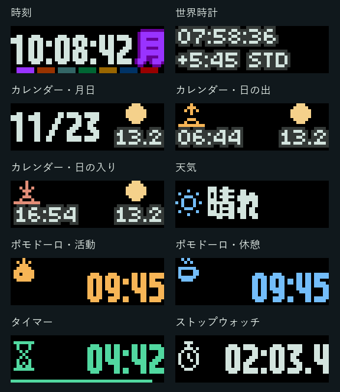
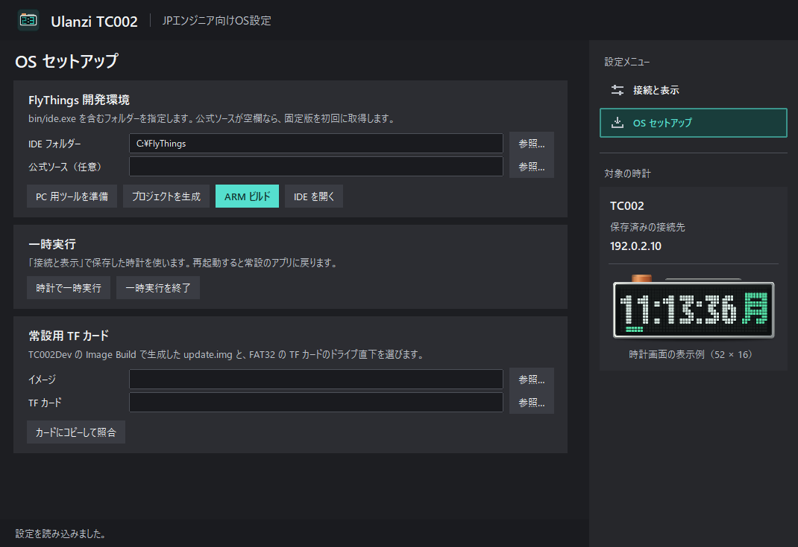

# Ulanzi_TC002_for-JPEngineers

Ulanzi TC002 の 52 × 16 ドット画面で日本語の時計、タイマー、天気、開発作業の状況を表示するコミュニティプロジェクトです。Windows設定アプリ **Ulanzi TC002 JPエンジニア向けOS設定** と、時計の既存 Linux 上で動く独自の機器側アプリを同梱しています。Windows から接続と表示内容を設定し、このリポジトリのソースから自分の TC002 用のアプリを作成できます。



## クイックスタート

1. このリポジトリを Windows PC の書き込み可能なフォルダーにクローンするか、ソース ZIP を完全に展開します。Windows 版 Python 3.12（Tk、pip、Python ランチャーを含む）と Git for Windows を用意します。[Python](https://www.python.org/downloads/windows/)・[Git for Windows](https://gitforwindows.org/)
2. ルートの **`Ulanzi TC002 JPエンジニア向けOS設定.cmd`** をダブルクリックします。「接続と表示」で時計の IPv4 アドレス、地点名、緯度、経度を入力し、「設定を保存」を選びます。時計のアドレスは時計のネットワーク情報、Ulanzi Studio、またはルーターで確認できます。
3. 自分で機器側アプリを導入する場合は、下記の「初めて機器側アプリをビルドする」から進んでください。すでにこの独自アプリが動いている時計なら、「OS セットアップ」で FlyThings の IDE フォルダーを選び、「PC 用ツールを準備」を実行します。ADB を別途用意した場合は「接続と表示」で `adb.exe` を指定できます。「保存して起動」で PC から表示用データを送ります。PC と時計は同じ信頼できる LAN に接続します。

時計だけで使う機能には世界時計、ポモドーロ、BUSY、タイマー、ストップウォッチがあります。PC ブリッジは天気と開発サービスの情報を追加します。ボタン操作、表示の読み方、各サービスの取得範囲をまとめています。[スマートクロックの使い方](docs/operation.md)・[開発者向け画面の見本](docs/developer-preview.png)

## Windows 設定アプリの使い方

右側の「設定メニュー」から「接続と表示」と「OS セットアップ」を切り替えます。「対象の時計」の画像は表示例です。同じ欄の「保存済みの接続先」には、最後に保存した IPv4 アドレスが表示されます。PC ブリッジの稼働状態は「接続と表示」→「状態を確認」で照会します。応答、ビルドの進行状況、エラーは画面下部に表示され、別のページへ移っても確認できます。


| キー操作 | 用途 |
| --- | --- |
| Ctrl+Tab、Ctrl+Shift+Tab、Ctrl+Page Up、Ctrl+Page Down | ページを切り替える |
| Tab / Shift+Tab | 入力欄やボタンへ順に移動する。画面外の入力欄に移ると自動でスクロールします。 |
| Ctrl+S | 「接続と表示」の編集内容を保存する |

## 初めて機器側アプリをビルドする



| 用意するもの | 用途 |
| --- | --- |
| Windows PC、Python 3.12、Git for Windows | 設定画面の起動、上流ソースの取得、ビルドツールの実行 |
| FlyThings IDE 2.x と Z21 開発パッケージ | TC002 向け ARM 32-bit hard-float ビルド。開発時の IDE は 20260403 版、コンパイラーは GCC 8.3.0 |
| LAN に接続した TC002 | ビルド後の Wi-Fi ADB 一時実行と、PC ブリッジの表示確認 |
| FAT32 の TF（microSD）カードとカードリーダー | 常設する場合の更新イメージの受け渡し |

初回は公式サンプル、IDE の Z21 ツールチェーン・SDK 依存物、PC 側 Python パッケージを配布元から取得します。Windows の設定画面は Python 標準の Tk で動作します。FlyThings IDE はインストーラーが受け付ける空白のないフォルダーにインストールしてください。[FlyThings 公式ダウンロード](https://developer.flythings.cn/zh-hans/download.html)

1. **開発環境を指定する。** 「OS セットアップ」で、`bin/ide.exe` を含む親フォルダーを「IDE フォルダー」に指定します。「PC 用ツールを準備」を押して完了を待ちます。パッケージはこのチェックアウトの `build/` 配下に入ります。
2. **独自プロジェクトを生成する。** 「公式ソース（任意）」が空欄なら「プロジェクトを生成」が Ulanzi の基準コミットを取得します。すでに入手済みの場合は、同じコミットの公式 Git チェックアウト、またはその `Z21_TC002_Demo` フォルダーを指定します。生成先は `build/TC002Dev/` です。[基準コミット 677a3aa](https://github.com/UlanziTechnology/Ulanzi-U-Clock-TC002/tree/677a3aa89784bcb0b3e5ffa6db954efa0ce880de)
3. **初回の IDE ビルドを行う。** 「IDE を開く」を押し、FlyThings の **File → Import → General → Existing Projects into Workspace** を開きます。生成した `build/TC002Dev` を選び、**Copy projects into workspace** をオフのまま Finish を押します。TC002Dev を選択して **Ctrl+Alt+Z** でコード生成とビルドを実行します。Z21 ツールチェーンの取得を求められたらインストールし、依存パッケージの取得とビルドの完了を待ちます。
4. **ARM ビルドを確認する。** 設定アプリに戻って「ARM ビルド」を押します。`build/TC002Dev/Release/libzkgui.so` が機器側アプリです。追加の音源とライセンスは `build/TC002Dev/resources/tc002/` にあります。ビルドの詳細は `build/studio-logs/` のログで確認できます。

Z21 ツールチェーンと SDK がすでに揃っている PC では、設定アプリの「ARM ビルド」が固定版ソースから直接コンパイルします。独自アプリの実装はリポジトリの `firmware/` で変更してください。次回の生成・ビルドでもここから機器側プロジェクトに反映されます。

## 時計で一時実行する

1. 時計を起動して Wi-Fi に接続します。「接続と表示」で時計の IPv4 アドレスを保存します。FlyThings 付属の ADB は IDE フォルダー内の `sdk/platform-tools/adb/adb.exe` にあります。検出できない場合は「ADB」の「参照…」でこのファイルを選択します。
2. 「OS セットアップ」→「時計で一時実行」を押し、ダイアログに表示されたアドレスが自分の時計であることを確認します。成功すると時計に独自画面が表示されます。USB データ端子は通常ストレージ用です。実機のデバッグには Wi-Fi を使います。
3. 時計に天気や開発情報を表示するには、「接続と表示」で地点、必要に応じて GitHub の所有者または個別のリポジトリを設定し、「保存して起動」を押します。ブリッジの「状態を確認」と「停止」もここから操作できます。
4. 一時実行を終えるには「一時実行を終了」を選びます。時計の電源を入れ直しても、常設されている機器側アプリに戻ります。

## TF カードで常設する

常設すると、時計の電源を入れ直した後も更新した機器側アプリが起動します。ビルドした同じ版を一時実行し、ノブ、ボタン、表示、音を確認してから進めてください。

1. FlyThings IDE で生成済みの **TC002Dev** を選びます。ツールバーの **Image Build** 横の矢印から出力先を PC 上のフォルダーに指定し、Image Build（確認したバージョンでは **Ctrl+Alt+E**）を実行します。その出力先にできた `update.img` を使用します。
2. FAT32 のリムーバブルカードを PC に挿入します。エクスプローラーでドライブ文字と容量を確認します。設定アプリの「OS セットアップ」で、「常設用 TF カード」の「イメージ」に PC 上の `update.img`、「TF カード」にカードのドライブ直下（例 `E:\`）を指定します。
3. 「カードにコピーして照合」を押し、ファイルサイズ、ドライブ、ボリューム名を確認します。設定アプリは Z21 用の形式とファイル長を検査し、カードから読み戻した SHA-256 を表示します。同じイメージがあれば照合だけで完了します。別の `update.img` は PC に退避してください。自動更新を指示する `zkautoupgrade` がある場合は別のカードを選びます。完了後は Windows の「安全な取り外し」を行ってください。
4. 時計の電源を切り、カードを挿入して電源を入れます。時計の更新画面で対象を確認して更新を開始し、完了まで電源を維持します。更新後はカードを抜き、起動するアプリを確認します。[公式の更新手順](https://github.com/UlanziTechnology/Ulanzi-U-Clock-TC002/blob/677a3aa89784bcb0b3e5ffa6db954efa0ce880de/IDE使用说明/说明文档.md#制作升级镜像)

常設後に工場ファームウェアへ戻す手順は、一時実行の終了とは別です。Ulanzi は TC002 の USB-C 横の復旧ボタンを押したまま電源を入れる方法を案内しています。更新用カードは先に抜いてください。[TC002 の公式復旧案内](https://github.com/UlanziTechnology/Ulanzi-U-Clock-TC002/blob/677a3aa89784bcb0b3e5ffa6db954efa0ce880de/README_EN.md)

## うまく動かないとき

| 症状 | 確認すること |
| --- | --- |
| 設定画面が開かない | リポジトリを展開したフォルダーで PowerShell を開き、`py -3.12 -m tkinter` で Tk の確認窓が開くか試します。開いたら閉じて `py -3.12 -m studio` を実行し、表示されるエラーを確認してください。 |
| プロジェクトを取得できない | Git for Windows のインストール後に設定アプリを開き直してください。取得済みの公式 Git チェックアウトを使う場合は、上記の基準コミットを含んでいることを確認します。 |
| IDE やビルドが Z21 のコンパイラー・SDK を見つけられない | 「IDE フォルダー」に `bin/ide.exe` を含むインストール先を指定し、TC002Dev がある元の `build/TC002Dev` をインポートしてください。Z21 のツールチェーンを IDE で導入し、Ctrl+Alt+Z の完了後に設定アプリで再ビルドします。 |
| 時計が見つからない | 時計に現在表示される IPv4 と保存済みの値を照合し、PC と時計が相互通信できる LAN にいることを確認します。ルーターのゲストネットワークでは端末間の通信を制限する場合があります。 |
| 天気や開発情報が未取得のまま | 「状態を確認」で PC ブリッジが動作中か確認します。GitHub は利用する PC の GitHub CLI のログイン状態、監視する所有者名・リポジトリ名も確認してください。設定と取得元の詳細は [操作ガイド](docs/operation.md) にあります。 |
| TF カードを選べない | カードリーダーに挿し、Windows でリムーバブルかつ FAT32 と認識されることを確認してください。再フォーマットする場合はカード内の必要なファイルを先に退避します。 |

## 工場アプリの DIY 表示と開発資料

標準ファームウェアには HTTP/MQTT による DIY 表示もあります。`scripts/tc002-http.ps1` は、その通信を試すための PowerShell スクリプトです。最初のコマンドは送信予定の内容を表示します。`-DryRun` を外して `-Hello` を実行すると、`tc002_dev_hello` を作成・更新し、時計の表示先を切り替えます。

```powershell
$deviceIp = Read-Host "時計の IPv4 アドレス"
.\scripts\tc002-http.ps1 -DeviceIp $deviceIp -Hello -DryRun
.\scripts\tc002-http.ps1 -DeviceIp $deviceIp
```

- [操作、PC ブリッジ、テスト方法](docs/operation.md)
- [Windows設定アプリの要件](docs/studio-requirements.md)・[機器側アプリの要件と画面構成](docs/requirements.md)
- [Ulanzi の公式開発リポジトリ](https://github.com/UlanziTechnology/Ulanzi-U-Clock-TC002)・[FlyThings の IDE ガイド](https://github.com/UlanziTechnology/Ulanzi-U-Clock-TC002/blob/677a3aa89784bcb0b3e5ffa6db954efa0ce880de/IDE使用说明/说明文档.md)

## 動作確認

2026年11月24日、Windows・Python 3.12・FlyThings 20260403 で、固定版サンプルの取得から ARM ビルドと公式 IDE の Image Build まで確認しました。生成した `update.img` には常設用の起動設定、ビルドした ARM ライブラリ、自作効果音10点が入りました。Windows 側の回帰テストは設定保存、一時実行・復帰の ADB 応答、カードの交換、形式エラー、読み戻し不一致を含みます。

通常の Windows ランチャーから設定アプリを開き、保存済み設定の表示、ブリッジの状態確認、セットアップ画面からの ARM ビルド完了を確認しました。Windows 側の Python テストと HTTP のオフラインテストが通過しました。実際の Windows PowerShell とテスト用ブリッジで、起動・二重起動の防止・状態確認・停止も検証しています。時計側の C++ テスト9件は WebAssembly 上で実行しました。今回の版では、物理 TF カードからの常設更新と、更新後の実機での音・ボタン・復帰動作は未確認です。

## ライセンス

機器側ファームウェアとオリジナルの合成効果音は GPL-3.0-or-later、Windows アプリと PC ブリッジは MIT、同梱の3書体は SIL Open Font License 1.1 です。ビルド時に取得する公式サンプル、SDK、第三者部品については各配布元の条件を参照してください。[ライセンスの適用範囲](LICENSE)・[第三者素材の告知](THIRD_PARTY_NOTICES.md)
