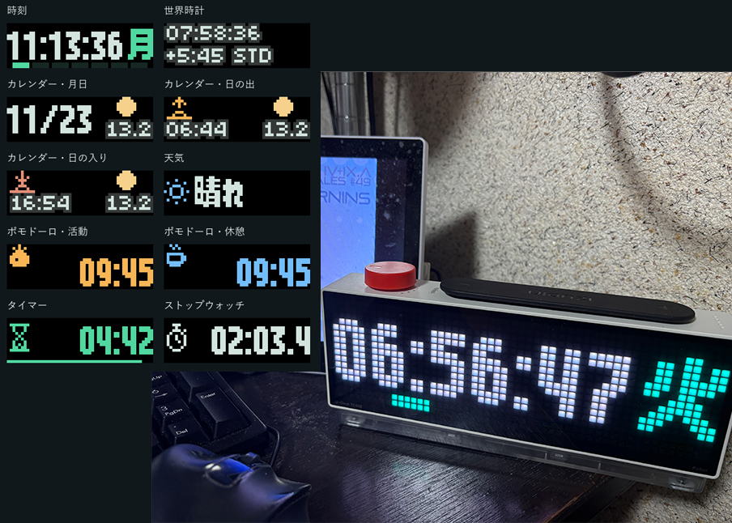
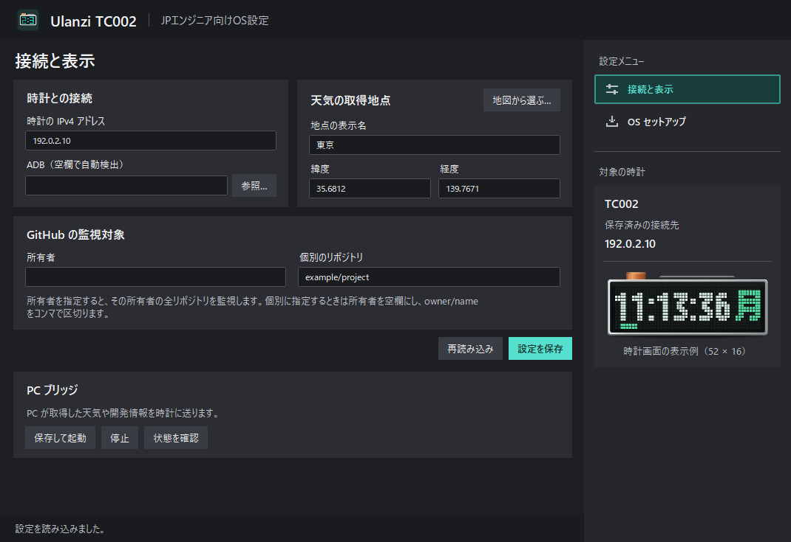

# Ulanzi_TC002_for-JPEngineers

Ulanzi TC002 の 52 × 16 ドット画面で日本語の時計、タイマー、天気、開発作業の状況を表示するコミュニティプロジェクトです。Windows設定アプリ **Ulanzi TC002 JPエンジニア向けOS設定** と、時計の既存 Linux 上で動く独自の機器側アプリを同梱しています。Windows から接続と表示内容を設定し、このリポジトリのソースから自分の TC002 用のアプリを作成できます。



| Windows 設定アプリ「接続と表示」 | Windows 設定アプリ「OS セットアップ」 |
| --- | --- |
| [](docs/studio-settings.png) | [](docs/studio-setup.png) |

## 初めて電源を入れる方へ

**一時実行と PC ブリッジには、標準OSでの Wi-Fi 接続が必要です。** すでに時計が PC と同じ LAN に再接続できる場合は、手順3から進めます。PC 上でのビルドと更新イメージの作成は時計の電源が切れた状態でも行えます。常設後も天気や開発情報を表示したい場合は、標準OSで先に Wi-Fi を設定してください。

1. TC002 の電源を入れ、初回の `CONNECT` 画面を待ちます。スマートフォンか PC の Wi-Fi 設定で時計の `U-Clock` に接続します。初期パスワードは公式ガイドに記載されています。[公式の初回接続ガイド（画面付き）](https://docs.ulanzistudio.com/tc002/en/software/web-setup.html)
2. 時計の Wi-Fi に接続したままブラウザーで `http://192.168.100.1` を開き、利用する **2.4 GHz** の Wi-Fi の SSID とパスワードを保存します。時計に `READY` が表示されたら、スマートフォンや PC を元の LAN に戻します。
3. 時計のノブで **4 - Tools → IP Address** を開き、ルーターが時計に割り当てた IPv4 アドレスを確認します。この値を下の手順で「時計の IPv4 アドレス」に入力します。

## クイックスタート

1. このリポジトリを Windows PC の書き込み可能なフォルダーにクローンするか、ソース ZIP を完全に展開します。Windows 版 Python 3.12（Tk、pip、Python ランチャーを含む）と Git for Windows を用意します。[Python](https://www.python.org/downloads/windows/)・[Git for Windows](https://gitforwindows.org/)
2. ルートの **`Ulanzi TC002 JPエンジニア向けOS設定.cmd`** をダブルクリックします。「接続と表示」で時計の IPv4 アドレスを入力し、「地図から選ぶ…」で天気の取得地点を選び、「設定を保存」を押します。地点名、緯度、経度は直接入力もできます。時計のアドレスは時計のネットワーク情報、Ulanzi Studio、またはルーターで確認できます。
3. 自分で機器側アプリを導入する場合は、下記の「初めて機器側アプリをビルドする」から進んでください。すでにこの独自アプリが動いている時計なら、「OS セットアップ」で FlyThings の IDE フォルダーを選び、「PC 用ツールを準備」を実行します。ADB を別途用意した場合は「接続と表示」で `adb.exe` を指定できます。「保存して起動」で PC から表示用データを送ります。PC と時計は同じ信頼できる LAN に接続します。

時計だけで使う機能には世界時計、ポモドーロ、BUSY、タイマー、ストップウォッチがあります。PC ブリッジは天気と開発サービスの情報を追加します。ボタン操作、表示の読み方、各サービスの取得範囲をまとめています。[スマートクロックの使い方](docs/operation.md)・[開発者向け画面の見本](docs/developer-preview.png)

## Windows 設定アプリの使い方

開発通知は BUSY タイマーの計時中にも流れます。ChatGPT の Dot から届く新着を時計に表示するには、PC ブリッジに加えてブラウザー拡張を設定してください。[Dot 新着通知の設定](docs/operation.md#chatgpt-dot-の新着を受け取る)

右側の「設定メニュー」から「接続と表示」と「OS セットアップ」を切り替えます。「対象の時計」の画像は表示例です。同じ欄の「保存済みの接続先」には、最後に保存した IPv4 アドレスが表示されます。PC ブリッジの稼働状態は「接続と表示」→「状態を確認」で照会します。応答、ビルドの進行状況、エラーは画面下部に表示され、別のページへ移っても確認できます。


| キー操作 | 用途 |
| --- | --- |
| Ctrl+Tab、Ctrl+Shift+Tab、Ctrl+Page Up、Ctrl+Page Down | ページを切り替える |
| Tab / Shift+Tab | 入力欄やボタンへ順に移動する。画面外の入力欄に移ると自動でスクロールします。 |
| Ctrl+S | 「接続と表示」の編集内容を保存する |

### 天気の取得地点を地図から選ぶ

1. 「接続と表示」→「天気の取得地点」→「地図から選ぶ…」を開きます。日本の地名や住所を入力して「検索」を押し、「検索候補」から目的の場所を選びます。
2. 地図をドラッグして移動し、ホイールで拡大・縮小できます。地点を直接指定するには、地図をクリックします。キーボードでは地図にフォーカスを移し、矢印キーで移動して Enter で中央の地点を選びます。
3. 「時計での表示名」を確認し、「この地点を使う」を押します。「接続と表示」に戻って「設定を保存」を押すと、次回の起動でも使えます。「キャンセル」で閉じると編集中の設定を保ちます。

地図を開くと国土地理院から表示範囲の地図を取得します。「検索」を押すと検索語を、地図上の地点を選ぶとその座標を国土地理院に送り、地名を照会します。海外は広域図で確認できます。通信が使えない場合は「接続と表示」で地点名と座標を直接入力してください。

地図の出典は国土地理院です。住所検索は東京大学空間情報科学研究センターのサービスを利用しています。[地理院タイル一覧](https://maps.gsi.go.jp/development/ichiran.html)・[広域図の出典](studio/assets/map-credits.txt)・[CSISシンプルジオコーディング実験を利用](https://geocode.csis.u-tokyo.ac.jp/)

### 時計の曜日配色を選ぶ（実装中）

「接続と表示」→「時計の曜日配色」で、時刻画面の曜日を色分けする範囲を5つから選び、「設定を保存」を押します。初期値は「すべての曜日を変更（祝日を含む）」で、日本の祝日は日曜と同じ赤になります。カレンダーには、日本の祝日と世界時計の地域の祝日も表示されます。[曜日の配色と祝日](docs/operation.md#曜日の配色と祝日)

## 初めて機器側アプリをビルドする


| 用意するもの | 用途 |
| --- | --- |
| Windows PC、Python 3.12、Git for Windows | 設定画面の起動、上流ソースの取得、ビルドツールの実行 |
| FlyThings IDE 2.x と Z21 開発パッケージ | TC002 向け ARM 32-bit hard-float ビルド。開発時の IDE は 20260403 版、コンパイラーは GCC 8.3.0 |
| LAN に接続した TC002 | ビルド後の Wi-Fi ADB 一時実行と、PC ブリッジの表示確認 |
| FAT32 の TF（microSD）カードとカードリーダー（任意） | 更新イメージを PC からカードにコピーする場合のみ使用 |

初回は公式サンプル、IDE の Z21 ツールチェーン・SDK 依存物、PC 側 Python パッケージを配布元から取得します。Windows の設定画面は Python 標準の Tk で動作します。FlyThings IDE はインストーラーが受け付ける空白のないフォルダーにインストールしてください。[FlyThings 公式ダウンロード](https://developer.flythings.cn/zh-hans/download.html)

1. **開発環境を指定する。** 「OS セットアップ」で、`bin/ide.exe` を含む親フォルダーを「IDE フォルダー」に指定します。「PC 用ツールを準備」を押して完了を待ちます。パッケージはこのチェックアウトの `build/` 配下に入ります。
2. **独自プロジェクトを生成する。** 「公式ソース（任意）」が空欄なら「プロジェクトを生成」が Ulanzi の基準コミットを取得します。すでに入手済みの場合は、同じコミットの公式 Git チェックアウト、またはその `Z21_TC002_Demo` フォルダーを指定します。生成先は `build/TC002Dev/` です。[基準コミット 677a3aa](https://github.com/UlanziTechnology/Ulanzi-U-Clock-TC002/tree/677a3aa89784bcb0b3e5ffa6db954efa0ce880de)
3. **初回の IDE ビルドを行う。** 「IDE を開く」を押し、FlyThings の **File → Import → General → Existing Projects into Workspace** を開きます。生成した `build/TC002Dev` を選び、**Copy projects into workspace** をオフのまま Finish を押します。TC002Dev を選択して **Ctrl+Alt+Z** でコード生成とビルドを実行します。Z21 ツールチェーンの取得を求められたらインストールし、依存パッケージの取得とビルドの完了を待ちます。
4. **ARM ビルドを確認する。** 設定アプリに戻って「ARM ビルド」を押します。`build/TC002Dev/Release/libzkgui.so` が機器側アプリです。追加の音源とライセンスは `build/TC002Dev/resources/tc002/` にあります。ビルドの詳細は `build/studio-logs/` のログで確認できます。

Z21 ツールチェーンと SDK がすでに揃っている PC では、設定アプリの「ARM ビルド」が固定版ソースから直接コンパイルします。独自アプリの実装はリポジトリの `firmware/` で変更してください。次回の生成・ビルドでもここから機器側プロジェクトに反映されます。

## 時計で一時実行する

1. 時計を起動して Wi-Fi に接続します。「接続と表示」で時計の IPv4 アドレスを保存します。FlyThings 付属の ADB は IDE フォルダー内の `sdk/platform-tools/adb/adb.exe` にあります。検出できない場合は「ADB」の「参照…」でこのファイルを選択します。
2. 「OS セットアップ」→「時計で一時実行」を押し、ダイアログに表示されたアドレスが自分の時計であることを確認します。成功すると時計に独自画面が表示されます。USB データ端子は通常ストレージ用です。実機のデバッグには Wi-Fi を使います。
3. 時計に天気や開発情報を表示するには、「接続と表示」で地点、必要に応じて GitHub の所有者または個別のリポジトリを設定し、「保存して起動」を押します。ブリッジの「状態を確認」と「停止」もここから操作できます。
4. 一時実行を終えるには「一時実行を終了」を選びます。時計の電源を入れ直しても、常設されている機器側アプリに戻ります。

## 常設用の更新イメージを作成する

1. 決定音・回転音・秒針などの標準効果音を引き継ぐには、プロジェクト生成後、「OS セットアップ」→「Wi-Fi で常設する」→「時計から標準効果音を取り込む」を押します。すでに独自時計を常設し音源が欠けている場合は、「バックアップから取り込む」で同じ時計の `ui/audio` を選びます。取り込んだ音源は個人用の `build/TC002Dev/resources/audio/` に保存され、オフラインでもビルドできます。
2. FlyThings IDE で生成済みの **TC002Dev** を選びます。ツールバーの **Image Build** 横の矢印から出力先を PC 上のフォルダーに指定し、Image Build（確認したバージョンでは **Ctrl+Alt+E**）を実行します。出力先に `update.img` ができます。イメージの作成にカードは不要です。

## Wi-Fi で常設する

TC002 の標準アプリ 1.1.4 では、PC 上の `update.img` を同じ LAN 経由で時計に書き込めます。TF カードは不要です。標準アプリから一時実行を始めた場合は、通常再起動で標準アプリに戻ってから更新します。設定アプリの「OS セットアップ」→「Wi-Fi で常設する」からも手順を開けます。[Windows での更新と再起動後の確認](docs/wifi-update.md)

標準アプリ 2.x からの Wi-Fi 常設は未検証です。

すでに独自時計を常設している場合は、Wi-Fi ADB と FlyThings の更新機能で次のイメージを適用できます。標準アプリに戻さず実機で更新した手順を掲載しています。[独自時計からの更新](docs/wifi-update.md#resident-ota)

### TF カードにコピーを保管する（任意）

PC から TF カードにイメージを控えておく場合は、次の操作でコピーを照合できます。

1. FAT32 のリムーバブルカードを PC に挿入します。エクスプローラーでドライブ文字と容量を確認します。設定アプリの「OS セットアップ」で、「イメージ」に PC 上の `update.img`、「TF カード」にカードのドライブ直下（例 `E:\`）を指定します。
2. 「カードにコピーして照合」を押し、ファイルサイズ、ドライブ、ボリューム名を確認します。設定アプリは Z21 用の形式とファイル長を検査し、カードから読み戻した SHA-256 を表示します。同じイメージがあれば照合だけで完了します。別の `update.img` は PC に退避してください。自動更新を指示する `zkautoupgrade` がある場合は別のカードを選びます。完了後は Windows の「安全な取り外し」を行ってください。

工場ファームウェアに戻す場合、Ulanzi は TC002 の USB-C 横の復旧ボタンを押したまま電源を入れる方法を案内しています。[TC002 の公式復旧案内](https://github.com/UlanziTechnology/Ulanzi-U-Clock-TC002/blob/677a3aa89784bcb0b3e5ffa6db954efa0ce880de/README_EN.md)

## うまく動かないとき

| 症状 | 確認すること |
| --- | --- |
| 設定画面が開かない | リポジトリを展開したフォルダーで PowerShell を開き、`py -3.12 -m tkinter` で Tk の確認窓が開くか試します。開いたら閉じて `py -3.12 -m studio` を実行し、表示されるエラーを確認してください。 |
| プロジェクトを取得できない | Git for Windows のインストール後に設定アプリを開き直してください。取得済みの公式 Git チェックアウトを使う場合は、上記の基準コミットを含んでいることを確認します。 |
| IDE やビルドが Z21 のコンパイラー・SDK を見つけられない | 「IDE フォルダー」に `bin/ide.exe` を含むインストール先を指定し、TC002Dev がある元の `build/TC002Dev` をインポートしてください。Z21 のツールチェーンを IDE で導入し、Ctrl+Alt+Z の完了後に設定アプリで再ビルドします。 |
| 時計が見つからない | 時計に現在表示される IPv4 と保存済みの値を照合し、PC と時計が相互通信できる LAN にいることを確認します。ルーターのゲストネットワークでは端末間の通信を制限する場合があります。 |
| 天気や開発情報が未取得のまま | 「状態を確認」で PC ブリッジが動作中か確認します。GitHub は利用する PC の GitHub CLI のログイン状態、監視する所有者名・リポジトリ名も確認してください。設定と取得元の詳細は [操作ガイド](docs/operation.md) にあります。 |
| TF カードを選べない | カードリーダーに挿し、Windows でリムーバブルかつ FAT32 と認識されることを確認してください。再フォーマットする場合はカード内の必要なファイルを先に退避します。 |

## 工場アプリの DIY 表示と開発資料

標準ファームウェアには HTTP/MQTT による DIY 表示もあります。`scripts/tc002-http.ps1` は、その通信を試すための PowerShell スクリプトです。最初のコマンドは送信予定の内容を表示します。`-DryRun` を外して `-Hello` を実行すると、`tc002_dev_hello` を作成・更新し、時計の表示先を切り替えます。

```powershell
$deviceIp = Read-Host "時計の IPv4 アドレス"
.\scripts\tc002-http.ps1 -DeviceIp $deviceIp -Hello -DryRun
.\scripts\tc002-http.ps1 -DeviceIp $deviceIp
```

- [操作、PC ブリッジ、テスト方法](docs/operation.md)
- [Windows設定アプリの要件](docs/studio-requirements.md)・[機器側アプリの要件と画面構成](docs/requirements.md)
- [Ulanzi の公式開発リポジトリ](https://github.com/UlanziTechnology/Ulanzi-U-Clock-TC002)・[FlyThings の IDE ガイド](https://github.com/UlanziTechnology/Ulanzi-U-Clock-TC002/blob/677a3aa89784bcb0b3e5ffa6db954efa0ce880de/IDE使用说明/说明文档.md)

## 動作確認

2026年11月25日、BUSY 計時中の TC002 に、Chrome 拡張の登録先から Dot のテスト新着を1件送りました。実機の LED で「GPT dot新着通知」がスクロールし、BUSY の残り時間表示に戻ることを確認しました。同じ実機で時計側テスト9件とライブフィード検査が通過しました。

同日作成した常設用 `update.img` は 1,401,404 バイト、SHA-256 は `abd7b1f97311441db8cac91ff9b0db82db4b3cb4c3b7bb5b9c0ecf18e918d482` です。イメージを展開して全47ファイルを照合し、常設時に起動する `/res/lib/libzkgui.so` が実機から読み戻したライブラリとバイト単位で一致することを確認しました。

このイメージを標準アプリ 1.1.4 の Wi-Fi 更新で実機に書き込みました。更新時の自動再起動と、その後の通常再起動の両方で、時計が `/res/lib/libzkgui.so` を読み込んで稼働しました。各再起動後に読み戻した SHA-256 は実機で表示確認した版と一致し、PC ブリッジからのフィードも届きました。

同日、実機から取り込んだ標準の秒針音と自動時刻合わせを組み込んだ最終版を Wi-Fi ADB と FlyThings の更新機能で常設しました。個人用 `update.img` は 1,405,500 バイト、SHA-256 は `98f77e9ef40139636fcb93757959a7db0f2b5b19e6d06f41aa5c34bbeb0f6e7d` です。PC ブリッジ停止中の再起動後も時計単体で日本時間に同期し、PC との時刻差は1秒でした。通常の時刻画面で現在時刻と元の秒針音を確認しました。

2026年11月24日、公開用の履歴を新規クローンし、ローカル設定とビルド出力のない状態から試しました。Windows PC には Python 3.12、Git、FlyThings IDE 20260403 と Z21 開発パッケージを用意しました。

- **初期設定とビルド**　設定アプリで時計と天気の設定を保存・再読み込みし、「PC 用ツールを準備」「プロジェクトを生成」「ARM ビルド」を順に実行しました。公式ソース欄を空にした状態で固定版サンプルを取得し、32ビット ARM ライブラリと効果音10点を生成しました。
- **実機への一時導入**　更新用カードを抜いて電源を入れ直し、標準時計と Wi-Fi 接続に戻った TC002 で一時実行しました。本体が実行中のライブラリの SHA-256 が今回のビルドと一致し、独自時計の表示とノブでの画面切り替えを実機で確認しました。
- **常設用イメージ**　同じ新規プロジェクトを FlyThings IDE の Image Build で再ビルドし、1,397,308 バイトの `update.img` を生成しました。イメージ内の ARM ライブラリを IDE の出力とバイト単位で照合し、常設用の起動設定と効果音10点も確認しました。テスト用フォルダーをカードのコピー先として、初回コピー後と再実行時の読み戻し SHA-256 が生成元と一致しました。物理 TF カードからの更新と常設後の再起動は未検証です。
- **回帰テスト**　Windows の Python テスト60件、PowerShell の HTTP オフラインテスト、時計側 C++ テスト9件が通過しました。C++ テストは WebAssembly にコンパイルして実行しました。PC ブリッジの起動、二重起動の防止、状態確認、停止も Windows PowerShell とテスト用プロセスで確認済みです。

## ライセンス

機器側ファームウェアとオリジナルの合成効果音は GPL-3.0-or-later、Windows アプリと PC ブリッジは MIT、同梱の3書体は SIL Open Font License 1.1 です。ビルド時に取得する公式サンプル、SDK、第三者部品については各配布元の条件を参照してください。[ライセンスの適用範囲](LICENSE)・[第三者素材の告知](THIRD_PARTY_NOTICES.md)
