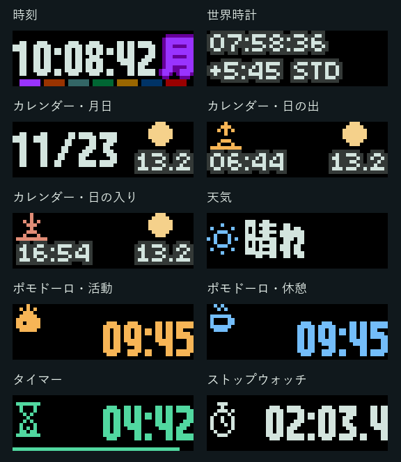
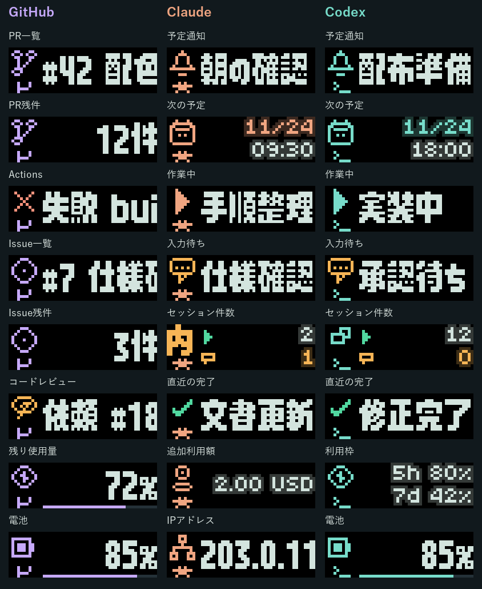
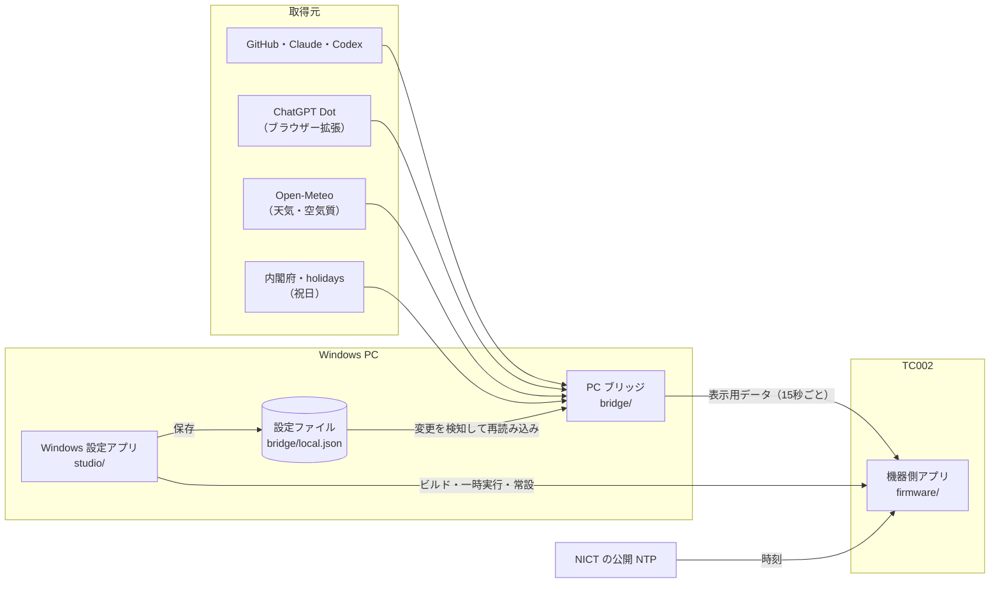

# 機能の全体像

Ulanzi_TC002_for-JPEngineers の機能を1ページにまとめた案内です。操作や仕様の詳細は、各行のリンク先が正本です。

| 時計の画面 | 開発連携の画面 |
| --- | --- |
|  |  |

## 構成

時計の画面・入力・音・計時は TC002 の既存 Linux 上で動く機器側アプリが担い、PC がスリープしても動き続けます。天気や開発サービスの情報は Windows PC の PC ブリッジが集め、同じ LAN の Wi-Fi ADB で時計へ送ります。Windows 設定アプリは設定の保存と、機器側アプリのビルド・導入を受け持ちます。

| 部分 | 場所 | 役割 | 要件 |
| --- | --- | --- | --- |
| 機器側アプリ | `firmware/` | 52 × 16 ドットの表示、ノブと3ボタン、効果音、各タイマーの計時 | [機器側の要件](requirements.md) |
| PC ブリッジ | `bridge/` | 天気・開発サービス・祝日の収集、時計への配信、通信断の記録 | [PC 側の収集](operation.md#pc側の収集と地点設定) |
| Windows 設定アプリ | `studio/` | 接続先と表示の設定、PC ブリッジの起動・停止、ビルドと導入 | [設定アプリの要件](studio-requirements.md) |

## 時計だけで使える機能

ノブで **GitHub・Claude・Codex・時計** の4つの大カテゴリと、それぞれ8つの小カテゴリをたどります。時計カテゴリの画面は PC がなくても動きます。

| 画面・機能 | できること | 詳しく |
| --- | --- | --- |
| 時刻 | 時分秒と、右端の漢字・下端の帯で今日の曜日を表示。曜日ごとの配色と祝日の赤 | [曜日の配色と祝日](operation.md#曜日の配色と祝日) |
| 世界時計 | UTC−12〜＋14 を15分・1時間刻みで調整し、夏時間の ON／OFF を切り替える | [ボタン](operation.md#ボタン) |
| カレンダー | 月日・日の出・日の入り・月齢。祝日には日本と世界時計の地域の祝日ページを追加 | [机上で読む画面](operation.md#机上で読む画面) |
| ポモドーロ | 活動25〜45分（5分刻み）と休憩。活動は琥珀色、休憩は青色 | [ボタン](operation.md#ボタン) |
| BUSY | どの画面からもノブ＋中央で呼び出し、BUSY と REST を計時 | [ボタン](operation.md#ボタン) |
| タイマー | 1〜1440分。期限後はアラームと超過時間を表示 | [ボタン](operation.md#ボタン) |
| ストップウォッチ | 1時間未満は0.1秒、以後は時・分・秒で表示 | [ボタン](operation.md#ボタン) |
| 電池・IP | 電池残量と時計の IPv4。4カテゴリ共通 | [ボタン](operation.md#ボタン) |
| 時刻合わせ | 起動後に NICT の公開 NTP から UTC を取得。届かない環境では PC ブリッジのデータで合わせる | [スマートクロックの使い方](operation.md) |
| 音量 | ノブ＋左右で0〜6 | [ボタン](operation.md#ボタン) |

ポモドーロ、BUSY、通常タイマー、ストップウォッチは独立して計時し、別の画面を開いても進み続けます。

## 音

| 音 | 鳴る場面 | 詳しく |
| --- | --- | --- |
| 秒針・操作音 | 時刻画面・世界時計・計時中の毎秒、モード切替・ノブ・ボタン。時計から取り込んだ標準効果音を使い、欠けている音は同梱の合成音で補う | [スマートクロックの使い方](operation.md) |
| 分の機械音 | 毎分の境界 | [スマートクロックの使い方](operation.md) |
| 2進数の時報 | 時刻画面と世界時計の正時に、表示時刻（1〜11時・13〜23時）を2進数で表すメロディー。正午は上行、午前0時は下降のメロディー | [スマートクロックの使い方](operation.md) |
| 計時の合図 | タイマー満了、ポモドーロ・BUSY の休憩入りと活動再開 | [スマートクロックの使い方](operation.md) |
| 通知音 | スクロール通知の表示開始 | [GitHub・Claude・Codex](operation.md#机上で読む画面) |

音が重なったときは、①通常タイマーの期限アラーム、②BUSY・ポモドーロの区間切り替え、③時報・秒針の順に優先します。[BUSYと効果音](requirements.md#busyと効果音)

## PC ブリッジで加わる情報

| 情報 | できること | 詳しく |
| --- | --- | --- |
| 天気 | 地点・空模様・気温・湿度・気圧・最高／最低気温・空気質を自動で切り替えて表示。地点はカレンダーの日の出・日の入りと共用 | [PC 側の収集と地点設定](operation.md#pc側の収集と地点設定) |
| GitHub（8画面） | PR 一覧・PR 残件・Actions・Issue 一覧・Issue 残件・レビュー・利用残量 | [セッション、予定、契約枠](operation.md#セッション予定契約枠) |
| Claude・Codex（各8画面） | 予定通知・次の予定・作業状況・入力待ち・件数・直近の完了・利用残量 | [セッション、予定、契約枠](operation.md#セッション予定契約枠) |
| 利用残量と追加クレジット | 契約枠の残率とリセットまでの時間、今期の追加消費と上限 | [机上で読む画面](operation.md#机上で読む画面) |
| スクロール通知（7種類） | Issue 起票・PR 作成・PR 終了・GitHub Action 失敗・Claude 入力依頼・Codex 入力依頼・GPT dot 新着通知。BUSY・REST の計時中も流れる | [机上で読む画面](operation.md#机上で読む画面) |
| ChatGPT Dot の新着 | Edge・Chrome の拡張機能が新着の ID と時刻だけをブリッジへ渡す | [Dot の新着を受け取る](operation.md#chatgpt-dot-の新着を受け取る) |
| 祝日と曜日配色の設定 | 日本と世界時計の代表地域の祝日、設定アプリで選んだ配色を時計へ送る | [曜日の配色と祝日](operation.md#曜日の配色と祝日) |
| 通信断・未取得の表示 | 最終取得値と取得日時を `OLD`・`OFF` 付きで表示し、初回は「未取得」と明示 | [机上で読む画面](operation.md#机上で読む画面) |
| 確認日時付きの取込 | 自動取得できない予定・状態・金額を、サービス画面で確認した日時とともに JSON で取り込む | [確認日時付きの取込](operation.md#確認日時付きの取込) |

ブリッジは認証に PC の既存の GitHub CLI・Copilot・Codex を使います。時計からレビュー承認やタスク実行を行う操作はありません。

## Windows 設定アプリ

ルートの **`Ulanzi TC002 JPエンジニア向けOS設定.cmd`** で起動します。右側の「設定メニュー」で2つのページを切り替えます。[Windows 設定アプリの使い方](../README.md#windows-設定アプリの使い方)

| ページ | できること |
| --- | --- |
| 接続と表示 | 時計の IPv4 と ADB、天気の地点（地図と住所検索）、GitHub の監視対象、時計の曜日配色を保存し、PC ブリッジを起動・停止・状態確認する |
| OS セットアップ | PC 用ツールの準備、独自プロジェクトの生成、IDE の起動、ARM ビルド、時計での一時実行と終了、標準効果音の取り込み、Wi-Fi 常設の手順、TF カードへのコピーと照合 |

## 導入と更新

| 方法 | 内容 | 詳しく |
| --- | --- | --- |
| 一時実行 | Wi-Fi ADB でビルドを時計の `/tmp` に置いて起動する。電源を入れ直すと常設のアプリに戻る | [時計で一時実行する](../README.md#時計で一時実行する) |
| Wi-Fi で常設 | 標準アプリ 1.1.4 の更新 API で `update.img` を書き込む。2.x からは未検証 | [Wi-Fi で常設する](wifi-update.md) |
| 独自時計からの更新 | 常設済みの独自時計に、Wi-Fi ADB と FlyThings の更新機能で次のイメージを適用する | [独自時計からの更新](wifi-update.md#resident-ota) |
| TF カードへのコピー（任意） | `update.img` を FAT32 カードにコピーし、読み戻した SHA-256 で照合する | [TF カードにコピーを保管する](../README.md#tf-カードにコピーを保管する任意) |

## 開発者向け

| 項目 | 内容 | 詳しく |
| --- | --- | --- |
| テスト | Python の unittest、PowerShell の HTTP オフラインテスト、時計の一時領域で動かす ARM テスト、配信中フィードの検査 | [確認](operation.md#確認) |
| 画面見本 | 実機の描画コードで開発モードの48場面を出力する | [確認](operation.md#確認) |
| 工場アプリの DIY 表示 | 標準ファームウェアの HTTP/MQTT 表示を `scripts/tc002-http.ps1` で試す | [工場アプリの DIY 表示](../README.md#工場アプリの-diy-表示と開発資料) |
| AI エージェントとの共同開発 | Claude Code・Codex 共通の開発指示とブランチ運用 | [AGENTS.md](../AGENTS.md) |

## 開発状況

- **実装済み**　曜日の配色と祝日表示（2026年11月28日）。Windows設定、PCブリッジ、時計画面とカレンダーを一体で確認しています。
- **未検証**　物理 TF カードからの更新と常設後の再起動、標準アプリ 2.x からの Wi-Fi 常設。
- **実機での確認記録**　[README の動作確認](../README.md#動作確認)・[操作ガイドの確認](operation.md#確認)
