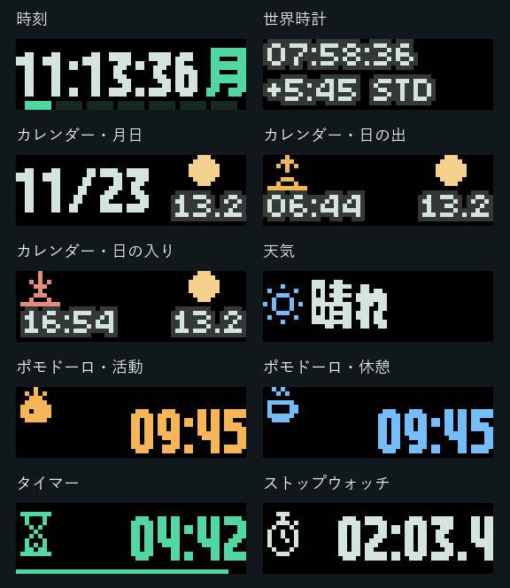

# スマートクロックの使い方

通常の時刻画面には時分秒と曜日が出ます。右端の漢字と、最下段2ドットの月曜始まりの帯が今日の曜日を示します。秒針には本体の標準音または同梱した効果音を使います。分、時、日付の境界では順に強くかみ合う音を使います。

## ボタン

| 場面 | 操作 |
| --- | --- |
| 階層移動 | 画面からノブを短押しして小カテゴリ選択へ。もう一度短押しすると大カテゴリ選択。回して選び、短押しで小カテゴリ選択、長押しで選んだ画面に入る。 |
| 一覧・天気・カレンダー・電池／IP | ノブを回すか左右単押しで次／前。中央短押しでも次へ。枠に収まる文字は静止。長いIPアドレス・地名・リポジトリ名は先頭で1秒待ってから1ドットずつ流れ、末尾も1.2秒保持します。 |
| 全画面 | ノブを押しながら中央でBUSYを開く／元の画面へ戻る。ノブ＋左右で音量0〜6。 |
| 世界時計 | 左右短押しで15分、650ミリ秒以上の長押しで1時間。離したときに1回適用。中央で夏時間＋1時間のON／OFF。基本時差はUTC−12〜＋14。上段は現地の時分秒、下段は適用後のUTC時差とSTD／DST。 |
| ポモドーロ・BUSY | 中央で開始・一時停止・再開、中央長押しでリセット。待機中は左で活動時間、右で休憩時間を変更。活動は琥珀色、RESTは青色。 |
| タイマー | 停止中に左右で1分、左右長押しで10分ずつ設定。1〜1440分。中央で開始・一時停止。超過時はアラームと＋表示。タイマー画面で中央を押すと消音して設定時間へ戻る。 |
| ストップウォッチ | 中央で開始・一時停止、中央長押しでリセット。1時間未満は0.1秒表示。 |

ポモドーロ、BUSY、通常タイマー、ストップウォッチは独立して計時します。BUSY中に到来した予定は履歴で確認できます。通常タイマーの期限はBUSY中にも通知します。電池／IPは4大カテゴリで共通です。

## 机上で読む画面

カレンダーは月日・日の出・日の入りを約4.5秒ずつ表示します。右側は上に月の満ち欠け、下に月齢を表示し続けます。日の出は上向き矢印、日の入りは下向き矢印です。

天気は地点、空模様、気温、湿度、気圧、最高・最低気温、空気質を左のアイコンで区別します。操作せずに次の項目へ進みます。各項目は少なくとも約3.6秒表示し、長い文字列では末尾まで読む時間を取ります。左右で戻った項目も先頭から読み直せます。

タイマーとストップウォッチは左端に砂時計・ストップウォッチのアイコン、右端に計時値を表示します。ポモドーロの左上は活動中はトマト、休憩中はカップになり、残り時間は右下に大きく出ます。世界時計などの2段表示には、文字の内側を明るく、縁を暗く描いたネガクリップを使います。

次の見本は、時計と同じ描画コードに例示用の時刻・天気・IPアドレスを渡し、52×16ドットの出力を5倍に拡大したものです。[IPアドレスのスクロール見本（GIF）](ip-scroll.gif)



### GitHub・Claude・Codex

左上のアイコンは項目と状態、左下の小さな記号はサービスを示します。GitHubは紫の分岐、Claudeは橙の星、Codexはミント色のプロンプトです。小カテゴリを選ぶと、下段の8目盛りが現在位置を示します。ノブで選択を変えると表示は即座に切り替わります。

| 見たいこと | 時計での読み方 |
| --- | --- |
| PR・Issue・レビュー | 番号とタイトルを先に、続いてリポジトリ名を読みます。残件数は右揃え。Actionsの失敗は赤橙の×、成功・復旧は緑のチェックで、文字でも結果が分かります。 |
| AIの予定 | 予定日と時刻を上下に2.4秒表示してからタスク名へ切り替えます。長い名前は終わりまで1ドットずつ流れます。 |
| 作業・入力待ち | 作業中は三角、入力待ちは琥珀色の吹き出し、完了はチェック。件数画面は上に作業中、下に入力待ちを表示します。左に「内」がある件数は確認できた範囲の内数です。次の行で対象範囲を確認できます。 |
| 利用枠と追加額 | 1つの残率には残量ゲージ、2つの利用枠には上下2行を使います。追加利用額はコインの記号と金額・通貨で表示します。 |
| 未取得・通信断 | 未取得は文字で明示します。保存値がある場合は値を読み終えた後に取得日時を出します。切断時は `OFF`、古い値・日時付き取込は `OLD` が目印です。 |

画面見本は架空のリポジトリ・予定・金額を使い、TC002の描画コードの出力を拡大しています。各画像には3サービスの全24画面を収録しています。[普段の表示](developer-preview.png)・[長文・0件・通信断・未取得の表示](developer-stress.png)

## ビルドと実機起動

Windows 設定アプリで公式サンプルの準備、機器側プロジェクトのビルド、一時起動・復元、更新用 TF カードの準備ができます。初回の IDE 操作と各手順の順番は [セットアップ手順](../README.md) を参照してください。

ビルドしたアプリは `build/TC002Dev/Release/libzkgui.so`、生成した音とライセンスは `build/TC002Dev/resources/tc002/` にあります。一時実行の配置先は時計の `/tmp` です。常設用のビルドには独自合成の MP3 効果音を10点同梱します。一時実行では、時計の標準の `Clock.mp3` とエンコーダーを利用できれば、分・時・日付の3音を PC の一時フォルダーで生成して使います。電源を入れ直すと、時計に常設されているアプリに戻ります。常設ビルドでは設定を本体の `/data/tc002-dev.prefs` に保存します。[音源の由来と再生成手順](../THIRD_PARTY_NOTICES.md)

## PC側の収集と地点設定

Windows 設定アプリで時計の IPv4 アドレス、GitHub の監視対象、天気の地点を保存します。手動設定では `bridge/local.example.json` を `bridge/local.json` にコピーし、`device` に時計の IPv4 アドレスを指定してください。`owner` には所有者名を指定できます。認証中の利用者から見える、その所有者の公開・非公開リポジトリが対象になります。個別に選ぶ場合は `owner` を外し、`repos` に `owner/name` を並べます。

設定アプリから起動・停止するほか、PowerShell からも操作できます。以下の例では Windows の Python ランチャーで、設定アプリと同じ Python 3.12 を選びます。

```powershell
$clockPython = py -3.12 -c "import sys; print(sys.executable)"
.\scripts\start-bridge.ps1 -Python $clockPython
py -3.12 -m bridge status
py -3.12 -m bridge places "東京都新宿区"
py -3.12 -m bridge set-place "新宿区" --lat 35.6938 --lon 139.7034
.\scripts\start-bridge.ps1 -Stop
```

市区町村名で設定する場合は `set-place "市区町村名"` を使います。候補が複数あるときは番号を表示し、`--pick 番号` で確定します。離島は同じ市町村内でも座標を直接指定できます。天気・空気質・日出入りが同じ座標を使います。月齢は平均朔望月からの近似値、日出入りは標準大気差を含む太陽高度からの計算値です。[国土地理院の地図](https://maps.gsi.go.jp/)・[Open-Meteo の天気](https://open-meteo.com/en/docs)・[空気質](https://open-meteo.com/en/docs/air-quality-api)

ブリッジは15秒ごとに表示用データをWi-Fi ADBで時計へ送ります。認証にはPCの既存のGitHub CLI・Copilot・Codexを使います。デスクトップに表示する短い状態名やリポジトリのタイトルを送るため、信頼できるLANで使用してください。PCがスリープすると最終取得値は琥珀色になり、確認日・時刻と交互表示になります。フィードのない初回は「未取得」です。予定通知のために先の予定も配信します。本体の上限は小カテゴリ当たり100行、通知は直近から128件です。件数は元の一覧全体で計算します。

## セッション、予定、契約枠

| 表示 | 取得経路 |
| --- | --- |
| GitHubのPR・Issue・審査・Actions | 所有リポジトリのGraphQLとREST。下書きPRを含め、IssueにはPRを含めません。Actionsは各リポジトリ直近100実行を照合し、失敗と同じワークフロー・ブランチの復旧を通知します。初回は既存履歴の一斉通知を抑えます。 |
| 個人のGitHub通知 | 通知APIを読める場合は受信箱を使います。通知 API にアクセスできない場合は、PR・Issueの新規・更新・終了を比較して表示します。 |
| Codex | 自動化の定義と繰り返しから次の予定を計算します。残率はApp Serverの契約枠。共有サーバーがある場合はセッション状態を照会します。プロジェクトフックでも進行状況を取得できます。 |
| Claude Code | `claude agents --json --all` とプロジェクトフックを使います。正常応答、入力／承認待ち、失敗・中断を区別します。Claude CodeのステータスラインJSONに含まれる5時間／7日枠は、`scripts/receive-hook.py statusline` に標準入力で渡せます。 |
| Claude DesktopのCode・Cowork | ホストが対応するフックの状態を受け取れます。Coworkの状態、Code・Coworkの予定、契約枠など、ホストが提供しない項目は下記の日時付き取込を使います。Codeの予定ファイルは削除後も残り、有効状態・実行時刻を含みません。[Claudeの予定管理](https://code.claude.com/docs/en/desktop-scheduled-tasks) |
| 利用額 | GitHubは個人の月別AIクレジット利用レポートの実請求額。アカウントの権限で読めない金額、Claude・Codexの実追加利用額は日時付き取込。残率と金額の片方だけでも表示でき、未取得と0を区別します。 |

このプロジェクトでのフックの登録は `scripts/setup-hooks.py` で再現できます。Codexはアプリ設定のHooksで受信用コマンドへの信頼を確認すると有効になります。Claude側は次の対象セッションでプロジェクト設定を読み込みます。フックはセッションIDのハッシュ、短い表示名、状態と時刻を記録します。時計からレビュー承認・タスク実行を行う操作はありません。[Codexのフック](https://developers.openai.com/codex/hooks/)・[Claudeのフック](https://code.claude.com/docs/en/hooks)・[Claudeの状態一覧](https://code.claude.com/docs/en/agent-view)

### 確認日時付きの取込

次のJSON形式で、サービス画面で確認した欄だけを保存し、`py -3.12 -m bridge import ファイル名.json` を実行します。例の日時と金額は書式見本です。自動収集で確認できた最新の契約値が優先されます。日付はタイムゾーンを含むISO形式です。金額が確認できないときは欄を省略します。

```json
{
  "provider": "claude",
  "scope": "cowork",
  "observedAt": "2026-11-23T21:30:00+09:00",
  "remainingPercent": 72,
  "extraSpent": {"amount":"2.00","currency":"USD","period":"2026-11"},
  "sessions": [{"id":"task-18","label":"レビュー","state":"waiting"}],
  "schedules": [{"id":"daily-check","label":"朝の確認","enabled":true,
                 "occurrences":["2026-11-24T09:00:00+09:00"]}]
}
```

`provider` は `github`・`claude`・`codex`、`scope` は `account`・`code`・`cowork`・`desktop`。状態は `working`・`waiting`・`completed`・`failed`・`closed`。同一サービス・範囲の一覧はその確認時点の全件を渡します。空配列は確認済み0件を意味します。暦月と異なる請求期間では `period` の代わりに `periodStart` と `periodEnd` をタイムゾーン付きで指定できます。範囲外になった追加額は今期の表示から外れます。

## 確認

```powershell
py -3.12 -m unittest discover -s tests
.\tests\tc002-http.tests.ps1
$deviceIp = Read-Host "時計の IPv4 アドレス"
.\tests\run-native.ps1 -DeviceIp $deviceIp -CheckLiveFeed
```

ARMテストは時計の一時領域で実行します。`-CheckLiveFeed` はPCから配信中のフィードを本体のコードで開き、鮮度・地点・天気・切断表示を確認します。診断用の `/tmp/tc002-dev.audio` は専用音のデコーダー完了またはエラーを記録します。実機で分の二段音・秒針音・BUSYの往復を確認済みです。時・日付変更の音は、境界判定と生成した波形の相対強度をテストしています。

開発モードの画面を再確認するには、最新版をビルドした後、実機テストに `-DeveloperPreview` を追加します。通常データと長文・未取得・0件を含むデータの2組、計48場面を描画します。Pillowを使用できるPythonで `tests/system/render_developer_preview.py` を実行すると、両方の見本を `build/native-tests/` に出力します。
