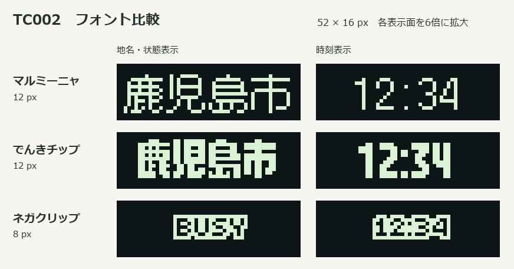

# TC002 開発者向けスマートクロック 要件定義 v0.1

2026-11-23 利用者確認済み。Q19の短押し・長押しに関する最終指定を反映。日本語で開発する人が、机上のTC002で時刻と作業状況を確認し、手元で計時できるようにする。各表の確認例は、試作や実機で合否を判定するための基準である。

## 利用者要件

ノブで大カテゴリとその配下の小カテゴリをたどれる、標準OSに準じた操作を採用する。大カテゴリは **GitHub・Claude・Codex・時計** の4つ。

### 本体と開発PCの役割

- **Q1・Q2　本体と開発PC**　既存Linux上でFlyThings/C++の機器側アプリが画面・操作・音・計時を担う。時刻表示と各タイマーはPCがスリープしても本体で動く。開発サービスの認証・情報収集は同じLANの開発PCが担う。
- **Q3・Q4・Q9　開発連携**　対象はWindowsのGitHub Copilotデスクトップアプリ（GitHub Copilot app）、GPT Codexデスクトップアプリ、Claude Desktop。各アプリを普段どおり使いながら時計上で情報を閲覧・切り替えできることを確認する。レビュー・承認・AIへの指示はPCで行う。
- **Q6・Q12　国内の地点**　離島を含む市区町村をPCで選び、同じ市町村内でも緯度・経度で地点を指定できる。地点は時計本体に保存し、天気と日出・日没で共用する。PCがスリープしていても、保存地点の日出・日没を本体で確認できる。

### 開発サービスの小カテゴリ（Q10）

各カテゴリのメニュー順は次のとおり。ClaudeとCodexにはそれぞれ8項目を設け、選んだサービスの予定・セッション・使用枠を表示する。

| 順序 | GitHub | Claude・Codexそれぞれ |
| --- | --- | --- |
| 1 | PR通知・一覧 | タスクスケジュール通知 |
| 2 | PR残件 | 次のタスクスケジュール（一覧） |
| 3 | Action通知 | 作業中セッション状況 |
| 4 | Issue通知・一覧 | 入力待ちのセッション一覧 |
| 5 | Issue残件 | 作業中+入力待ちのセッション件数 |
| 6 | コードレビュー状況 | 直近の完了セッション |
| 7 | トークン残量 | トークン残量 |
| 8 | 電池残量+IPアドレス | 電池残量+IPアドレス |

PR通知とPR一覧は同じ小カテゴリ内で扱う。Issue通知とIssue一覧も同様。「Action通知」の対象はGitHub Actions。「電池残量+IPアドレス」は時計を含む全4カテゴリから同じTC002本体の状態を参照する。

- **Q14　一覧と残件**　PCで指定したリポジトリの未完了PR（open。ドラフトを含む）とオープンIssueを、それぞれの一覧・件数で同じ条件で集計する。例えばドラフト1件・通常の未完了PR1件・オープンIssue3件なら、PR残件は2、Issue残件は3。マージ済み・クローズ済みPRはPR残件から、PRはIssue残件から除外する。コードレビューは「自分への依頼」と「自分のPRの審査状況」を区別する。
- **Q15　Claude Desktop**　CodeとCoworkの両方を、予定の通知・一覧と、セッションの状態・一覧・件数・直近の完了の対象にする。取得時には同じ予定やセッションを重複計上しないことを確認する。
- **Q16・Q18　利用残量**　GitHub・Claude・Codexの各画面で、契約枠の残率と、取得元のリセット時刻までの残日数・残時間を表示する。追加欄は今期の消費量を請求通貨またはクレジット単位で示し、予算上限も分かる場合は「消費量 / 上限」とする。予算の消費率だけが分かる場合はその割合を表示し、概算額には「約」を付ける。残率と追加消費は個別に扱い、確認できた0と「取得不可」を区別する。
- **Q17　スケジュール**　両AIサービスとも、アプリに登録済みの有効な予定を次の実行予定時刻が近い順に並べ、その時刻の到来を通知する。予定時刻に達した後も、実行開始を確認できた場合にだけ「開始」と表示する。例えば10時の予定でPCがスリープしていれば、10時になっただけでは開始扱いにしない。
- **Q21　Actions通知**　指定リポジトリのワークフロー実行が失敗した時、およびその後に同じワークフロー・同じブランチで初めて成功した時に通知する。例えば成功・失敗・成功・成功の順なら通知は2回。別ブランチの成功は元ブランチの復旧扱いにしない。通常の成功も実行一覧に表示する。
- **Q22　直近の完了セッション**　ひとつの依頼への応答が正常終了した時点で、そのセッションを掲載する。回答・承認が必要と判別できる間は入力待ちに残す。失敗・中断は完了件数に含めない。
- **Q23　他画面での開発通知**　短い通知は数秒間表示する。長い通知は末尾までスクロールして読み取り時間を確保し、次の通知または元画面へ移る。BUSY中は開発通知を一覧に記録し、表示中の画面を保つ。通常タイマーの期限はBUSY中も知らせる。
- **Q26　通信断**　PCとの接続が切れたら、件数・利用額・天気には最終取得値と取得時刻を表示する。初めて起動して値がなければ「未取得」とする。セッションは切断前の状態であることを示し、切断から実行継続や完了を推定しない。本体の時計・各タイマー・保存地点の日出入りは継続する。

### ノブと3ボタンの割り当て

ノブは回転と押し込みができるつまみ。Q13で、全画面の共通操作をノブとの同時押しに、各モードの操作をボタン単独に割り当てた。

| 操作 | 動作 | 受け入れ時の確認例 |
| --- | --- | --- |
| ノブを押しながら中央 | すべてのモードからBUSYを呼び出す。BUSY表示中は元の画面へ戻る。 | 世界時計からBUSYへ入り、同じ操作で戻ると元の時差・夏時間設定で表示される。 |
| ノブを押しながら−／＋ | 音量を下げる／上げる。 | 世界時計でノブを保持したまま＋を2回押すと、音量が上限に達するまでは2段階上がり、時差は保持される。 |
| 中央を単独で短押し | 表示中のモードの主操作。世界時計では夏時間の切り替え、BUSYでは計時の開始・一時停止・再開。 | 世界時計で中央を1回押すと、同じ画面で夏時間の状態が1回だけ切り替わる。 |
| −／＋を単独で短押し | 表示中のモードの副操作。世界時計では基本のUTC時差を15分ずつ減らす／増やす。 | UTC+5:30から＋短押しでUTC+5:45、−短押しでUTC+5:30に戻る。 |
| −／＋を単独で長押し | 世界時計では基本のUTC時差を1時間ずつ減らす／増やす。 | UTC+5:30から＋長押し1回でUTC+6:30、−長押し1回でUTC+5:30に戻る。長押しの前後に15分が加算されず、音量・夏時間も保持される。 |
| ノブだけを回す／押す | 標準の階層移動を基準にする。 | 同時押しに使ったノブを離した時、余分な階層移動が発生しない。 |

標準の左右長押しには明るさ調整がある。独自OSの世界時計では左右長押しを1時間調整に使う。明るさの割り当てと長押しの判定時間は試作で決める。[標準の物理操作](https://www.ulanzi.com/products/tc002-pixbar-smart-pixel-clock-ii)

### 時計の小カテゴリ

| 画面 | 実機で確かめる振る舞い | 次に決める詳細 |
| --- | --- | --- |
| 世界時計 | 上段には時・分・秒、下段には夏時間適用後のUTC時差とSTD／DSTを同時表示する。−／＋単独の短押しで15分ずつ、長押しで1時間ずつ基本時差を調整する。中央単独で夏時間を手動切替し、ONなら1時間進める。例として基本UTC−5でONならUTC−4とDSTを表示し、OFFでUTC−5に戻る（Q19最終指定と実機での追記）。 | 基本時差はUTC−12〜＋14。日またぎを確認する |
| 時刻 | 時刻SEはこの画面で発音する。例として12時34分には分の音、13時00分には時の音だけ、翌日0時00分には日付変更音だけを各1回鳴らす。他画面で同じ境界をまたぐ場合は時刻SEを鳴らさない（Q11）。 | 消音設定、時刻補正で境界をまたいだ場合の扱い |
| カレンダー | 月・日・月齢・日出時刻・日没時刻を確認できる。天気の地点を変更すると、その地点での日出・日没が反映される。年号・西暦年・祝日表示は対象外。 | 52×16での表示順、月齢の精度、各値の更新時刻 |
| 天気 | 標準の天気表示を引き継ぎ、国内の市区町村と離島を対象に指定できる地点を増やす。PCで市区町村または座標を指定し、カレンダーと同じ地点を使う。 | 予報区域と座標の対応、提供元・更新間隔、取得できない時の表示 |
| ポモドーロタイマー | 標準の計時操作を維持する。活動と休憩を画面色で区別し、休憩開始と活動再開をそれぞれSEで知らせる。 | 配色、標準設定値の扱い、画面を離れた時の通知 |
| タイマー | アナログゲージと数字で計時する。期限まではtick音を鳴らし、期限に達したらアラームに切り替えて超過時間を表示する。1分設定の65秒後は5秒超過。タイマー画面で中央単独を押すと同時に消音・計時停止・超過値のリセットを行い、次の開始を待つ。他画面の中央単独はそのモードの機能を保つ（Q20）。 | 設定範囲、tick間隔、アラームの反復間隔 |
| ストップウォッチ | 標準の計時機能を保持する。1時間未満の計測中は分・秒・0.1秒で表示する。59:59.9の次は1:00:00とし、以後は時・分・秒を表示する（Q25）。 | 桁の切り替えと0.1秒表示の読みやすさを実機で確認する |
| 電池残量＋接続IPアドレス | 1つの小カテゴリ内で残量と接続IPの両方を確認できる。 | 同時表示か交互表示か、長いIPv4アドレスと未接続時の表示 |

### BUSYと効果音

実機確認で追加した秒針SEは時刻画面で毎秒鳴らす。分・時・日付の境界では該当する専用SEを1回だけ鳴らす。

時刻画面では、下2ドットを7曜日の帯に使い、右端にも現在の曜日を漢字1字で表示する。分・時・日付変更の音は標準秒針をもとに、順に強くかみ合う機械音とする。分境界の二段音とノブ＋中央のBUSY切り替えは利用者が実機確認済み。

BUSYタイマーは4大カテゴリのどの画面からも共通ショートカットで呼び出せる。カテゴリ一覧にBUSYの起動項目は置かない。標準のBUSY計時を基準に、BUSYからRESTへの移行時に休憩開始SE、RESTからBUSYへの移行時に再開SEを鳴らす。ポモドーロとBUSYは別の機能として扱う。

**Q8　並行計時**　通常タイマー・ストップウォッチ・ポモドーロ・BUSYは独立して動作する。例えばポモドーロとストップウォッチを動かしたままBUSYを開いても、それぞれの時間は進み続ける。通常タイマーの期限はどの画面でも知らせる。BUSYでも画面の呼び出し・復帰と、計時の開始・一時停止・再開を別の操作にする。

既存の操作音を活かし、時計の境界・タイマーの期限・活動と休憩の切り替わりを聞き分けるための音を追加する。発音が重なった時は①通常タイマーの期限アラーム、②BUSY・ポモドーロの区間切り替え、③時報・tick音の順で優先する。アラーム中に省略した時報は後から鳴らし直さない（Q24）。各遷移の直前・直後と、画面の再表示で同じSEが重複しないかを確認する。

### 日本語表示

患者長ひっくさんの「でんきチップ」「ネガクリップ」を使用する。「マルミーニャ」を追加候補として比較する。以下の割り当ては表示案。各画面の文字量は、描画に使えるピクセル幅から決める。

| 書体 | 作者仕様 | TC002での用途案と確認例 |
| --- | --- | --- |
| でんきチップ | 高さ12px。文字送りは漢字10px、かな8px、数字6px。JIS第1水準漢字を収録。 | 主表示・地名用。52pxをすべて使っても漢字のみなら5字。「鹿児島市」は40pxだが、「南さつま市」のような混在表記は実際の文字送りで計算する。 |
| ネガクリップ | 高さ8px。かな・英数字・記号など約450グリフ。多くは5px送りの可変幅で、文字の外縁が重なる。 | 短い状態名や数字用。「BUSY」「REST」などを等倍で確認する。2段表示は上下の字形が接触しないか確認する。 |
| マルミーニャ（追加候補） | 12px基準の丸文字。作者公称でJIS第1水準2,965字・第2水準3,390字を収録。GitHub版v1.500でSIL OFL 1.1へ移行。 | 地名や短い日本語見出し用。第2水準を含む地名の補完にも使える。公式TTFを12pxで描画した「鹿児島市」は48pxで収まり、「12:34」は30px。採用範囲は表示面での読みやすさを見て決める。[作者の書体紹介](https://booth.pm/ja/items/4927023)・[公式リポジトリ](https://github.com/hicchicc/x12y12pxMaruMinya) |

各黒枠は公式TTFを52×16の画素面に等倍で描き、比較用に6倍に拡大したもの。「鹿児島市」の文字送りはマルミーニャで48px、でんきチップで40px。横にアイコンを添える画面では残り幅がそれぞれ4px、12pxになる。実機では同じ輝度と距離で漢字の細部を見比べる。

実機での追加指定に合わせ、収まりきらない地名・IP・一覧は1ドットずつ横スクロールする。ネガクリップは明暗を反転し、字面に暗いフチを付ける。でんきチップにない漢字はマルミーニャで補う。3書体のGitHub版はSIL Open Font License 1.1。各書体の著作権表示とライセンス本文を配布物に添付する。[でんきチップ](https://github.com/hicchicc/x8y12pxDenkiChip)・[ネガクリップ](https://github.com/hicchicc/x5y8pxNegaClip)・[マルミーニャのライセンス](https://github.com/hicchicc/x12y12pxMaruMinya/blob/main/OFL.txt)

通常タイマーとストップウォッチは左端に種類別アイコン、右端に計時値を置く。ポモドーロは活動・休憩のアイコンを左上、残り時間を右下に大きく表示する。天気は項目アイコンと観測値を一緒に自動切り替えする。カレンダーの右側は月相アイコンとその下の月齢で固定し、左側は月日・日の出・日の入りを自動切り替えする。

## 開発の前提と実機での確認点

- TC002の表示面は52×16 RGB。公開されている開発経路は、既存Linux上のFlyThings/C++機器側アプリからLED・キー・音声を制御するもの。公式サンプルのビルド成果物は `libzkgui.so`。このPCの基準コミットと再ビルド手順は[開発環境README](../README.md)に記録してある。[公式開発ガイド](https://github.com/UlanziTechnology/Ulanzi-U-Clock-TC002/blob/main/README_EN.md)
- 標準の階層移動はノブ回転・押下が中心。中央短押しは通常画面ではBUSY、ポモドーロ等の機能操作に入ると開始・一時停止にも使う。独自OSではノブを一緒に押しているかで共通操作と機能操作を区別する。[階層操作](https://docs.ulanzistudio.com/tc002/en/faq/)・[ツール操作](https://docs.ulanzistudio.com/tc002/en/tools/guide.html)
- 公式ボタンテストはノブ・左・中央・右の押下状態を個別に表示できる。実機ではノブを保持したまま各ボタンを1回押し、2キーの押下・解放を識別できるか、離す順序を変えて確認する。共通操作を行った時にモード操作や階層移動が重複発火しないことを確かめる。物理同時押しは実機未検証。[公式ボタンテスト](https://github.com/UlanziTechnology/Ulanzi-U-Clock-TC002/blob/677a3aa89784bcb0b3e5ffa6db954efa0ce880de/Z21_TC002_Demo/src/pages/BtnTestPage.cpp)
- 世界時計では左・右それぞれの短押しと長押しを区別する。単独長押し1回で時差だけが1時間変わり、ノブを押しながら同じボタンを操作した場合は音量だけが変わることを実機で確認する。
- サンプルには物理ボタンの押下・解放イベントとMP3再生例がある。工場標準SEを独自アプリから参照できるか、配布物に同梱できるかは未確認。まず実機で標準操作と音の対応を記録し、参照方法を確認する。サンプル同梱の1kHz試験音は操作音の見本として扱わない。[キー処理](https://github.com/UlanziTechnology/Ulanzi-U-Clock-TC002/blob/main/Z21_TC002_Demo/src/managers/KeyManager.cpp)・[音声デモ](https://github.com/UlanziTechnology/Ulanzi-U-Clock-TC002/blob/main/Z21_TC002_Demo/src/pages/AudioTestPage.cpp)・[同梱素材](https://github.com/UlanziTechnology/Ulanzi-U-Clock-TC002/blob/main/THIRD_PARTY_NOTICES.md)
- 標準ファームのHTTP/MQTT仕様にある時計・天気・ポモドーロ・BUSY設定は、動作比較の基準に使える。公開プロトコルで機器の物理キーをPCへ通知したり、任意の音を再生したりする機能は提供されていない。[公式プロトコル §5.6・§7](https://github.com/UlanziTechnology/Ulanzi-U-Clock-TC002/blob/main/protocol/Ulanzi_TC002_protocol-http-mqtt_CN.md)

### デスクトップ連携の取得候補と検証範囲

| 対象 | 公開資料で確認できたこと | このPCで確かめること |
| --- | --- | --- |
| GitHub Copilot app・GitHub | PR・Issueは検索、購読通知は通知API、Actionsはリポジトリのワークフロー実行から取得できる。Copilot SDKの `account.getQuota` は、提供された利用枠の残率・リセット日を返す。 | 指定リポジトリの一覧と残件を同じ条件で照合する。自分の通知とリポジトリ全体の実行を区別し、利用中の契約で取得できる枠と単位を確認する。[Copilot app](https://docs.github.com/en/copilot/get-started/where-to-use-github-copilot)・[検索](https://docs.github.com/en/rest/search/search#search-issues-and-pull-requests)・[通知](https://docs.github.com/en/rest/activity/notifications)・[Actions](https://docs.github.com/en/rest/actions/workflow-runs)・[利用枠](https://docs.github.com/en/copilot/how-tos/copilot-sdk/features/usage-and-billing) |
| GPT Codexデスクトップアプリ | アプリ内で予定と実行履歴を確認できる。App Serverには購読したスレッドの状態やターン終了を受ける機能、ChatGPTでサインインしたアカウントのCodex利用枠を扱う機能がある。 | 既存デスクトップで開いたセッションの入力待ちと終了を識別できるか、次の予定一覧をPC側で自動取得できるかを検証する。契約の利用率と個々の会話のトークン使用量は別の値として扱う。[予定](https://developers.openai.com/codex/app/automations/)・[App Server](https://developers.openai.com/codex/app-server/) |
| Claude Desktop | Codeでセッションのコンテキスト使用率とプラン使用量を確認できる。CodeとCoworkには予定機能がある。ChatとCoworkの統合は段階展開中。 | CodeとCoworkそれぞれで、既存の予定・入力待ち・終了をWindows側から取得できる範囲を検証する。契約枠は利用状況照会とDesktopの履歴から取得する。[取得範囲と設定](operation.md#セッション予定契約枠)・[Codeの使用量](https://code.claude.com/docs/en/desktop#check-usage)・[Codeの予定](https://code.claude.com/docs/en/desktop-scheduled-tasks)・[Coworkの予定](https://support.claude.com/en/articles/13854387-schedule-recurring-tasks-in-claude-cowork)・[ChatとCoworkの統合](https://support.claude.com/en/articles/16761823-claude-cowork-and-chat-are-one-claude) |

超過時の金額はサービスの契約・請求単位で照合する。個人が直接契約するGitHub Copilotには月別の請求利用レポートがある。Claudeの設定画面では当月の追加消費を確認でき、Codexでは契約枠に続いて利用するクレジットの残高・利用履歴を確認できる。購入額・残高・当期消費額は別の値であり、取得元が通貨額を提供しない場合の取り扱いを各サービスで検証する。[GitHubの請求利用API](https://docs.github.com/en/rest/billing/usage#get-billing-ai-credit-usage-report-for-a-user)・[Claudeの追加クレジット](https://support.claude.com/en/articles/12429409-manage-usage-credits-for-paid-claude-plans)・[Codexの個人向けクレジット](https://help.openai.com/en/articles/12642688-using-credits-for-flexible-usage-in-chatgpt-personal-plans)

## 試作で決めること

v0.1の対象は4カテゴリ各8小カテゴリ、入力操作、並行計時、通知と音、契約枠・追加利用額、通信断時の表示である。略称・配色・3書体の適用箇所、基本UTC時差の上下限、長押し判定時間、タイマーの設定範囲、天気・天文データの取得方法は試作で比較して決める。

ノブと各ボタンを組み合わせた操作、標準SEの流用、3サービスからの予定・状態・利用額などの自動取得は実機・対象クライアントで確認する。要求を満たせない項目が判明した時は、確認できた制約とその項目の代案を利用者と検討する。
